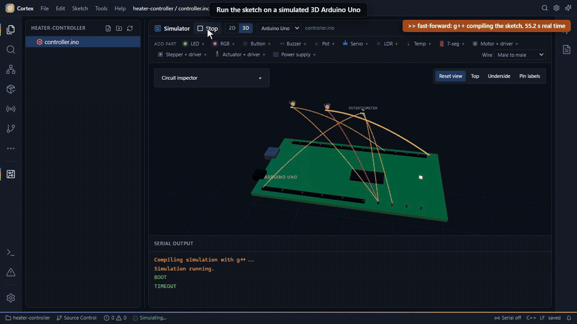
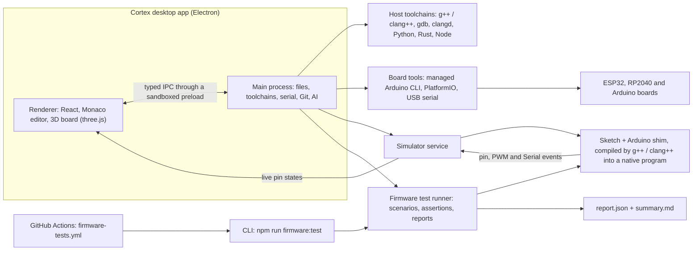
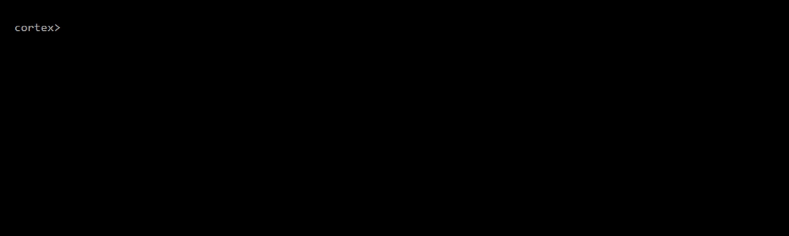

# Cortex

[](https://github.com/Blasted-ctrl/Cortex/actions/workflows/firmware-tests.yml)
[](https://github.com/Blasted-ctrl/Cortex/actions/workflows/ci.yml)

Cortex is a desktop app for writing, testing and running the code that goes on small electronics boards like Arduino, ESP32 and Raspberry Pi Pico. We built it because embedded work is scattered across an editor, board tools, serial terminals and test scripts that don't talk to each other, so Cortex is one Electron app that drives the real compilers, debuggers and board tools, and runs Arduino sketches on a simulated board so they can be tested before any hardware is plugged in.



<!-- VIDEO: Ali drags cortex-demo.mp4 into the GitHub editor here -->

[Watch the 50-second demo](docs/media/cortex-demo.mp4): open a project, run it on the 3D board, catch a real bug with the firmware tests, fix it, rerun. It is recorded by a script against the real app; compile waits are fast-forwarded with the real time shown, and [how it was made](docs/media/README.md) is documented.

## What it does

- Tests firmware automatically, without hardware. A JSON scenario feeds timed sensor readings to an Arduino Uno sketch and checks what it does with them, down to deadlines like "the heater must switch off between 470 and 480 ms after the sensor goes quiet". Every check in the report comes with the input and output events that prove it passed or failed.
- Runs sketches on a 3D board. LEDs, buttons, potentiometers, motors and steppers react to your actual code, and circuit checks flag problems like shorted supplies or a missing shared ground.
- Flashes and monitors real ESP32, RP2040 and Arduino boards through a managed Arduino CLI, and builds and uploads PlatformIO projects. The serial monitor can plot values live and reset the board to catch its boot output.
- Debugs C and C++ programs with gdb: breakpoints, call stack, variables, watches and a debug console.
- Builds modern host C++ (up to C++23) with your GCC or Clang, with clangd completion and automatic `#include`s. Python, Rust and JavaScript files can sit in the same project for test scripts and tooling.
- Runs in CI. A GitHub Actions workflow repeats every scenario three times to prove the results are reproducible, checks that broken and hanging firmware actually get caught, benchmarks the simulator and posts the reports to the job summary.
- Includes an optional AI assistant (Anthropic, OpenAI, Gemini, or a local model through Ollama or LM Studio) that can read the project and propose edits you approve one file at a time.

## How it works



The UI never touches the file system or spawns processes itself. It asks the main process through a small typed API exposed by a sandboxed preload script, and the main process runs the real tools.

Simulation doesn't emulate a chip. Cortex compiles your sketch together with a C++ implementation of the Arduino API (the "shim") into an ordinary program on your computer. That program reports every pin write, PWM change and `Serial.print` as a line of text, which the 3D board renders. The test runner uses the same shim in a deterministic mode where `millis()` and `delay()` follow a virtual clock, so a scenario produces the same timeline on every run, however fast or busy the host is.

## Firmware testing in CI

From a source checkout with Node.js and a host C++ compiler installed:

```bash
npm ci
npm run firmware:test       # the three example scenarios
npm run firmware:selftest   # proves a broken and a hanging firmware are caught
npm run firmware:bench      # times a fixed 60-second virtual workload
```



*Played back at 3x; most of the real run is g++ compiling each scenario.*

A passing run (commit `a922831`, Windows laptop, g++ 16.1):

```text
PASSED invalid-input: 14/14 assertions; 700ms virtual, 297.27ms host
PASSED normal: 8/8 assertions; 700ms virtual, 331.38ms host
PASSED sensor-timeout: 7/7 assertions; 650ms virtual, 415.62ms host
```

The repo also ships a deliberately broken controller that forgets to shut the heater off when its sensor stops updating. Running the stopped-sensor scenario against it fails with exit code 1:

```bash
npm run firmware:test -- examples/firmware-testing/scenarios/sensor-timeout.json --firmware examples/firmware-testing/fixtures/broken-timeout.ino --report-dir .cortex/broken-timeout
```

This is the assertion table from that run's `summary.md`:

| Assertion | Result | Virtual ms | Detail |
| --- | --- | ---: | --- |
| heating-before-loss | PASS | 460 | pwm pin 9 at 460ms: expected 180, observed 180 |
| sensor-timeout-shutdown | FAIL | 480 | pwm pin 9 = 0 not observed within [470, 480]ms |
| sensor-timeout-log | FAIL | 480 | Serial "TIMEOUT" not observed within [470, 480]ms |
| sensor-timeout-fault | FAIL | 480 | pin 13 = 1 not observed within [470, 480]ms |
| stale-sensor-stays-off | FAIL | 480 | pwm pin 9 in [0, 0] throughout [480, 650]ms: observed 180 |
| actuator-safety-limit | PASS | 650 | pwm pin 9 in [0, 180] throughout [0, 650]ms: within bounds |
| timeout-state-transitions | FAIL | 650 | Serial sequence: 2/3 states observed in order; missing "TIMEOUT" |

Below the table, the report lists the inputs leading up to the failure and the evidence for each failed check (here, the last PWM write on pin 9 was 180 at 20 ms and nothing turned it off). `report.json` holds the full timeline, compiler output and build fingerprints, and `--replay` reruns a saved report's inputs against a fixed sketch.

In GitHub Actions, the [firmware workflow](.github/workflows/firmware-tests.yml) runs on every pull request and push to `main` inside a pinned GCC 14.2 container. It typechecks, runs the unit tests, runs each scenario three times, runs the self-test and the benchmark, then uploads the reports and writes a summary. The [firmware-testing guide](docs/FIRMWARE-TESTING.md) covers the scenario format, assertion types, replay and baselines.

## Benchmarks

Measured with `npm run firmware:bench` (10 measured runs after 2 warmups; compilation excluded) at commit `817c0b4` on an Intel Core i5-1035G1 laptop running Windows 11, Node.js 24.12.0 and g++ 16.1.0 (MSYS2):

| Measurement | Median | p95 | Min | Max |
| --- | ---: | ---: | ---: | ---: |
| Host time to run the 60-second virtual workload (ms) | 93.65 | 111.62 | 86.42 | 111.62 |
| Virtual ms simulated per host second | 640,745 | 694,245 | 537,555 | 694,245 |
| Output events per host second | 202.90 | 219.84 | 170.23 | 219.84 |

Treat these as advisory. An earlier run on the same laptop, with other work going on, measured a 158.81 ms median. The CI workflow compares against a saved baseline and flags changes above 20% without failing the build. Host time includes starting the simulation process; it says nothing about how fast a real microcontroller runs.

## Getting started

To work from source, use Node.js 22.20.0 (the version CI pins) or a newer compatible release. The build tools need `^20.19.0 || >=22.12.0`. Installed desktop builds bring their own Electron runtime, so this only applies to source checkouts.

```bash
npm install
npm run dev
```

That starts the IDE in development mode with hot reload. To build a distributable app yourself:

```bash
npm run build
npm run dist:win
```

Native programs and the simulator use tools already on your machine. Board compilation and uploads use the board tools Cortex prepares for you:

| To do this | You need |
|---|---|
| Compile/run C or C++ | g++ / clang++ (anything recent supports C++23) |
| C/C++ code intelligence | clangd |
| Debug C/C++ | gdb |
| Run Python | python |
| Run Rust | Rust toolchain: rustc; Cargo for Cargo.toml projects |
| Run JavaScript | node |
| Flash boards, manage libraries | Cortex prepares board tools; install your board core in Boards Manager |

Open Settings → Toolchains in the app and it scans your machine and shows exactly what it found.

You don't need to download Arduino CLI yourself. First-time board setup and core installs need an internet connection, and Cortex shows progress and lets you retry. The [real-board quickstart](docs/BOARD-TOOLS.md) covers choosing a core, uploading, working offline and USB requirements.

The hammer next to Run builds without launching or uploading anything. In a PlatformIO project it saves your edited project files and runs `pio run`, even when the active file is a configuration file or a header. Build errors land in Problems with their source locations, and the full log stays in Output. More in [building projects and fixing build errors](docs/BUILDING-PROJECTS.md).

## Limitations

- Simulation runs your sketch as native C++ against an Arduino shim. It is not AVR instruction emulation: there's no cycle timing, no analog circuit solver and no I2C/SPI sensor models, and integer sizes and floating point follow your PC, not the chip. Only the Uno runs firmware; the ESP32, Raspberry Pi and Teensy 4.1 3D boards are for pin inspection and wiring checks.
- A passing simulation tests the behavior you asserted. It doesn't prove real-board timing or electrical safety.
- No release has been published yet, and builds are unsigned and don't auto-update. Run Cortex from source for now; installers will appear on the [Releases page](https://github.com/Blasted-ctrl/Cortex/releases).
- The CI badge is red because of one step: `npm audit --audit-level=high` reports 7 high-severity advisories, coming from Electron itself, the chokidar file watcher and Tailwind's build tooling. Typecheck, tests and the build pass on Ubuntu and Windows. Remediation is tracked in [dependency remediation](docs/DEPENDENCY-REMEDIATION.md).
- Code intelligence, the AI assistant and the simulator's accuracy are real but limited. The AI assistant needs a provider key or a local model.

## Project status

Cortex is early and under active development. The parts verified end to end are C++23 compiling, the simulator, the Arduino shim and the firmware test runner. [Production readiness](docs/PRODUCTION-READINESS.md) lists what's solid and what's still open, and the [release constraints](CONSTRAINTS.md) define the bar a build has to clear before it's customer-ready. Recent hardening work covers [local projects and save recovery](docs/PROJECTS.md), [Git workflows](docs/GIT.md) and the [simulation workbench](docs/SIMULATION-WORKBENCH.md).

<!-- TODO(Ali): add who uses Cortex today (for example, how many MASA developers) once there's a number you can back up. -->

More documentation lives in [`docs/`](docs/), including the [architecture](docs/ARCHITECTURE.md), the per-language support matrix, the debugger and the 3D simulator. The public product site has its own repository, [Vexaile/Vexaile-Main-Website](https://github.com/Vexaile/Vexaile-Main-Website).

## License

MIT
